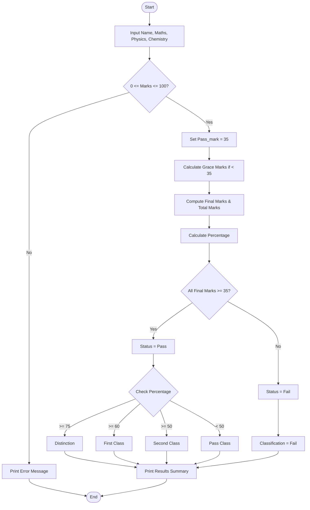

## Problem Statement

Examination Result and Grace-Mark Validation: Process marks across multiple subjects, apply subject-wise pass criteria and a specified grace-mark policy, and generate final classifications without exceeding maximum marks (100).

## Algorithm
```
Start the program and define configuration parameters (Pass Mark = 35, Maximum Mark = 100).

Read student details and iterate through the subjects (Maths, Physics, Chemistry).

For each subject, check if marks are between 0 and 100. If any mark is invalid, display an error message and terminate.

Apply Grace-Mark Policy:
For each subject, if the mark is below the Pass Mark, compute the required grace marks (Pass Mark - Original Mark).

Calculate the final subject mark, ensuring it does not exceed the maximum mark (100) using bounds capping (min(100, mark + grace)).

Compute Total and Percentage:
Sum all final subject scores to get Total Marks.
Calculate Percentage = Total Marks / Number of Subjects.

Determine Status and Classification:
If all final subject marks are >=35, set status to "Pass". Otherwise, set status to "Fail".
Assign academic classification based on percentage brackets (Distinction, First Class, Second Class, Pass Class, or Fail).

Display the Final Summary Report and Stop.
```
## Python source code
```
Name = input("Enter your name: ")
Maths = int(input("Enter your Maths marks: "))      
Physics = int(input("Enter your Physics marks: "))
Chemistry = int(input("Enter your Chemistry marks: "))

if (Maths < 0 or Maths > 100) or (Physics < 0 or Physics > 100) or (Chemistry < 0 or Chemistry > 100):
    print("Error: Marks must be between 0 and 100!")
else:
    Pass_mark = 35
    Grace_math = 0
    Grace_physics = 0
    Grace_chemistry = 0

    if Maths < Pass_mark:
        Grace_math = Pass_mark - Maths

    if Physics < Pass_mark:
        Grace_physics = Pass_mark - Physics

    if Chemistry < Pass_mark:
        Grace_chemistry = Pass_mark - Chemistry

    final_math = Maths + Grace_math
    final_physics = Physics + Grace_physics
    final_chemistry = Chemistry + Grace_chemistry

    total_marks = final_math + final_physics + final_chemistry
    percentage = total_marks / 3  

    if final_math >= Pass_mark and final_physics >= Pass_mark and final_chemistry >= Pass_mark:
        status = "Pass"
    else:
        status = "Fail"

    if status == "Fail":
        classification = "Fail"
    elif percentage >= 75:
        classification = "Distinction"
    elif percentage >= 60:
        classification = "First Class"
    elif percentage >= 50:
        classification = "Second Class"
    else:
        classification = "Pass Class"

    print("Math Final:", final_math)
    print("Physics Final:", final_physics)
    print("Chemistry Final:", final_chemistry)
    print("Total Marks:", total_marks)
    print("Percentage:", percentage)
    print("Status:", status)
    print("Classification:", classification)

```
## Sample Input
Enter your name: Rahul Sharma

Enter your Maths marks: 30

Enter your Physics marks: 78

Enter your Chemistry marks: 65
##  Sample Output

Math Final: 35

Physics Final: 78

Chemistry Final: 65

Total Marks: 178

Percentage: 59.33

Status: Pass

Classification: Second Class

## Flowchart



