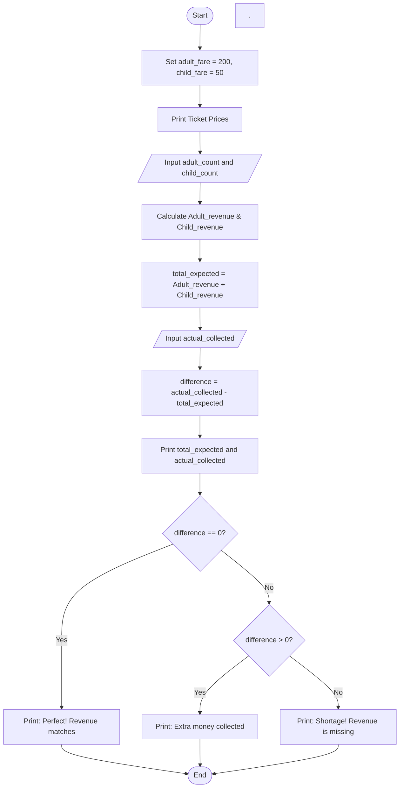

## Problem Statement

Write a program to manage and audit ticket collections for an event or transport service. The system should define fixed ticket prices for adults (Rs. 200) and children (Rs. 50). It should prompt the user to enter the number of adults and children who traveled, compute the total expected revenue, and take the actual cash/money collected as input. Finally, it must compare the expected and actual amounts to determine whether the revenue matches perfectly, has an excess (extra money), or shows a shortage.

## Algorithm

1.Initialize constants: Set adult_fare = 200 and child_fare = 50.

2.Display prices: Print the ticket prices for adults and children.

3.Get passenger counts:

4.Read adult_count as an integer.

5.Read child_count as an integer.

6.Calculate expected revenue:

7.Adult_revenue = adult_count * adult_fare

8.Child_revenue = child_count * child_fare

9.total_expected = Adult_revenue + Child_revenue

10.Get actual collection: Read actual_collected as a float/number.

11.Calculate difference: difference = actual_collected - total_expected

12.Display totals: Print total_expected and actual_collected.

13.Evaluate status using conditions:

14.If difference == 0, print that the revenue matches completely.

15.Else if difference > 0, print the extra money collected.

16.Else, print the shortage amount.

17.End

## Python Source Code

adult_fare = 200
child_fare = 50

print(f"Ticket Prices -- Adult: Rs.{adult_fare} | Child: Rs.{child_fare}")

adult_count = int(input("Enter number of adults traveled: "))
child_count = int(input("Enter number of children traveled: "))

Adult_revenue = adult_count * adult_fare
Child_revenue = child_count * child_fare
total_expected = Adult_revenue + Child_revenue

actual_collected = float(input("Enter total actual money collected (Rs.): "))
difference = actual_collected - total_expected

print("Total Expected Revenue: Rs.", total_expected)
print("Total Actual Collected: Rs.", actual_collected)

if difference == 0:
    print("Status: Perfect! Revenue matches completely (No difference).")
elif difference > 0:
    print("Status: Extra money collected by: Rs.", difference)
else:
    print("Status: Shortage! Revenue is missing by: Rs.", difference)

## Sample Input & Output
```A.Sample Input:&nbsp;
Number of adults traveled: 3
Number of children traveled: 2
Total actual money collected: 700

A.Sample Output:
Ticket Prices -- Adult: Rs.200 | Child: Rs.50
Enter number of adults traveled: 3
Enter number of children traveled: 2
Enter total actual money collected (Rs.): 700
Total Expected Revenue: Rs. 700
Total Actual Collected: Rs. 700.0
Status: Perfect! Revenue matches completely (No difference).

B.Sample Input:Number of adults traveled: 2
Number of children traveled: 1
Total actual money collected: 500

B.Sample OutputTicket Prices -- Adult: Rs.200 | Child: Rs.50
Enter number of adults traveled: 2
Enter number of children traveled: 1
Enter total actual money collected (Rs.): 500
Total Expected Revenue: Rs. 450
Total Actual Collected: Rs. 500.0
Status: Extra money collected by: Rs. 50.0
```

## Flowchart

