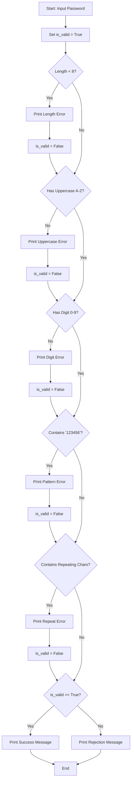

## Problem Statement
Write a Python program to validate a user's password based on specific security rules. The program must check if the password meets the following criteria:&nbsp;

Length: Must be at least 8 characters long.&nbsp;

Uppercase Letter: Must contain at least one uppercase letter (A-Z).&nbsp;

Digit: Must contain at least one number (0-9).&nbsp;

Prohibited Pattern: Must not contain the sequence "123456".&nbsp;

Repeating Characters: Must not contain consecutive repeating character sequences such as "aaa", "bbb", "ccc", "111", or "000".
&nbsp;
If the password passes all rules, print a success message; otherwise, display specific failure reasons for each violated rule and reject the password.


## Algorithm
```
1.Start the program and prompt the user to enter a password string.

2.Initialize a boolean flag is_valid to True.

3.Check Length: If the length of the password is less than 8 characters:

4.Print an error message.

5.Set is_valid = False.

6.Check Uppercase: Iterate/check if any uppercase letter from 'A' to 'Z' exists in the password.

7.If found, set has_upper = True.

8.If has_upper remains False, print an error message and set is_valid = False.

9.Check Digit: Check if any digit from '0' to '9' exists in the password.

10.If found, set has_digit = True.

11.If has_digit remains False, print an error message and set is_valid = False.

12.Check Prohibited Pattern: If "123456" is a substring of the password:

13.Print an error message.

14.Set is_valid = False.

15.Check Repeating Characters: If any sequence like "aaa", "bbb", "ccc", "111", or "000" is in the password:

16.Print an error message.

17.Set is_valid = False.

18.Final Result:
If is_valid is True, print a success message.

19.Else, print a rejection summary.

20.End the program.
```
## Python Source code

password = input("Enter a password to validate: ")

is_valid = True

if len(password) < 8:&nbsp;

    print(" Failed: Password is too short (Must be at least 8 characters).")
    is_valid = False

has_upper = False

if "A" in password or "B" in password or "C" in
password or "D" in password or "E" in password or "F" in password or "G" in password or "H" in password 
or "I" in password or "J" in password or "K" in password or "L" in password or "M" in password or "N" in password or 
"O" in password or "P" in password or "Q" in password or "R" in password or "S" in password or "T" in password or "U" in password 
or "V" in password or "W" in password or "X" in password or "Y" in password or "Z" in password:

    has_upper = True
if has_upper == False:

    print(" Failed: Missing an uppercase letter (A-Z).")

    is_valid = False
has_digit = False

if "0" in password or "1" in password or "2" in password or "3" in password or "4" in password or "5" in password 
or "6" in password or "7" in password or "8" in password or "9" in password:

    has_digit = True
if has_digit == False:

    print(" Failed: Missing a number (0-9).")

    is_valid = False
if "123456" in password:

    print(" Failed: Contains a prohibited pattern ('123456').")

    is_valid = False
if "aaa" in password or "bbb" in password or "ccc" in password or "111" in password or "000" in password:

    print(" Failed: Contains repeating characters in a row .")

    is_valid = False
if is_valid == True:

    print("Success: Your password is secure and meets all rules!")
else:

    print("Result: Password rejected. Please fix the errors above.")
## Sample Input & outputs

1.Sample Input:
abc123456&nbsp;

1.Sample Output:
```
Failed: Missing an uppercase letter (A-Z).
 Failed: Contains a prohibited pattern ('123456').
Result: Password rejected. Please fix the errors above.
```

2.Sample Input:
Secur3Pass!&nbsp;

1.Sample Output:
```
Success: Your password is secure and meets all rules!
```
## Flowchart



