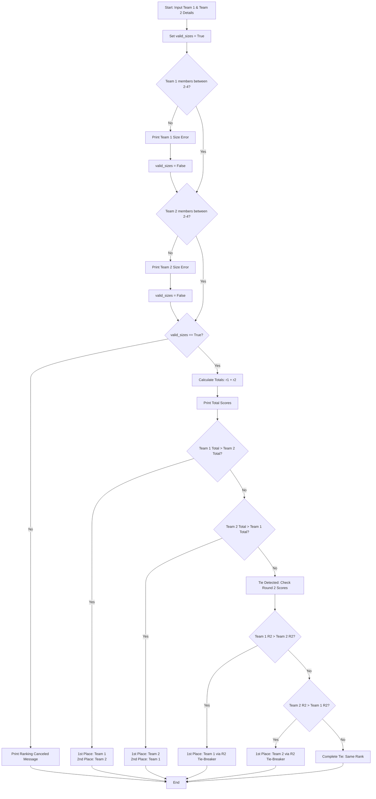

## Problem Statement 
Write a Python program to manage and rank two competing teams based on their member count and scores across two rounds. The program must:&nbsp;

Validate Team Sizes: Ensure that both Team 1 and Team 2 have between 2 and 4 members inclusive. If any team fails this rule, cancel the ranking.&nbsp;

Calculate Totals: Compute the total score for each team by summing their Round 1 and Round 2 scores.&nbsp;

Rank Teams: Compare total scores to determine 1st and 2nd place.

Handle Ties: If the total scores are equal, apply a tie-breaker rule where the team with the higher Round 2 score wins 1st place. If Round 2 scores are also identical, declare a complete tie.

## Algorithm
1.Start the program and prompt the user to input details for Team 1 (Name, number of members, Round 1 score, Round 2 score).

2.Prompt the user to input details for Team 2 (Name, number of members, Round 1 score, Round 2 score).

3.Initialize valid_sizes = True.

4.Validate Member Counts:

If Team 1 members < 2 or > 4$, print an error message and set valid_sizes = False.

If Team 2 members < 2 or > 4$, print an error message and set valid_sizes = False.

5.If valid_sizes is True:

Calculate team1_total = team1_r1 + team1_r2 and team2_total = team2_r1 + team2_r2.&ebsp;
Print total scores for both teams.
Compare totals:If team1_total > team2_total, Team 1 is 1st and Team 2 is 2nd.
If team2_total > team1_total, Team 2 is 1st and Team 1 is 2nd.

If equal (Tie):
Compare Round 2 scores (team1_r2 vs team2_r2).
Higher Round 2 score wins 1st place with a tie-breaker note.
If Round 2 scores are also equal, print "Complete Tie".

6.Else (if valid_sizes is False):Print a cancellation message.

7.End the program.


## 4. Python Source Code
```
print("Enter details for Team 1:")
team1_name = input("Team Name: ")
team1_members = int(input("Number of members (Allowed: 2 to 4): "))
team1_r1 = int(input("Round 1 Score: "))
team1_r2 = int(input("Round 2 Score: "))


print("\nEnter details for Team 2:")
team2_name = input("Team Name: ")
team2_members = int(input("Number of members (Allowed: 2 to 4): "))
team2_r1 = int(input("Round 1 Score: "))
team2_r2 = int(input("Round 2 Score: "))

print("\nCalculating results...\n")
valid_sizes = True

if team1_members < 2 or team1_members > 4:
    print(f"Error: {team1_name} has an invalid size! Must be between 2 and 4 members.")
    valid_sizes = False

if team2_members < 2 or team2_members > 4:
    print(f"Error: {team2_name} has an invalid size! Must be between 2 and 4 members.")
    valid_sizes = False


if valid_sizes:
    team1_total = team1_r1 + team1_r2
    team2_total = team2_r1 + team2_r2

    print(f"{team1_name} Total Score: {team1_total}")
    print(f"{team2_name} Total Score: {team2_total}")

    if team1_total > team2_total:
        print(f"1st Place: {team1_name}")
        print(f"2nd Place: {team2_name}")
        
    elif team2_total > team1_total:
        print(f"1st Place: {team2_name}")
        print(f"2nd Place: {team1_name}")
        
    else:
        print("Tie detected! Applying tie-breaker rule (Highest Round 2 score wins)...")
        
        if team1_r2 > team2_r2:
            print(f"1st Place: {team1_name} (Won via Round 2 tie-breaker)")
            print(f"2nd Place: {team2_name}")
        elif team2_r2 > team1_r2:
            print(f"1st Place: {team2_name} (Won via Round 2 tie-breaker)")
            print(f"2nd Place: {team1_name}")
        else:
            print("Complete Tie! Both teams share the same rank.")
else:
    print("Ranking canceled due to invalid team size(s). Please restart.")
```
## 5. Sample Input & Output
 A:Sample Input
 
Enter details for Team 1:
Team Name: CodeCrusaders
Number of members (Allowed: 2 to 4): 3
Round 1 Score: 45
Round 2 Score: 50

Enter details for Team 2:
Team Name: BugHunters
Number of members (Allowed: 2 to 4): 2
Round 1 Score: 30
Round 2 Score: 40
Sample Output:PlaintextCalculating results...

CodeCrusaders Total Score: 95
BugHunters Total Score: 70
1st Place: CodeCrusaders
2nd Place: BugHunters


B: Sample Input

Enter details for Team 1:
Team Name: Alpha
Number of members (Allowed: 2 to 4): 4
Round 1 Score: 40
Round 2 Score: 45

Enter details for Team 2:
Team Name: Beta
Number of members (Allowed: 2 to 4): 3
Round 1 Score: 35
Round 2 Score: 50
Sample Output:PlaintextCalculating results...

Alpha Total Score: 85
Beta Total Score: 85
Tie detected! Applying tie-breaker rule (Highest Round 2 score wins)...
1st Place: Beta (Won via Round 2 tie-breaker)
2nd Place: Alpha

## Flowchart 


